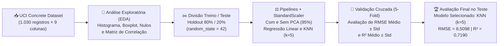
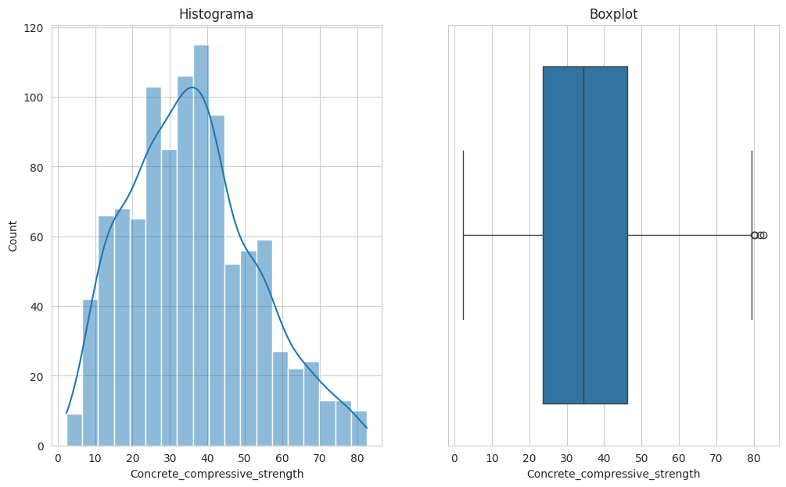
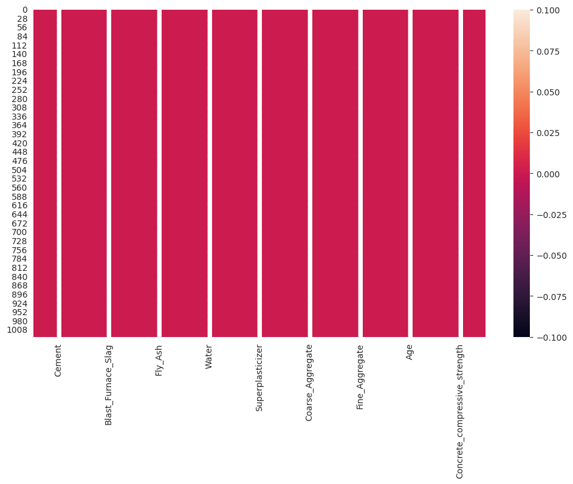
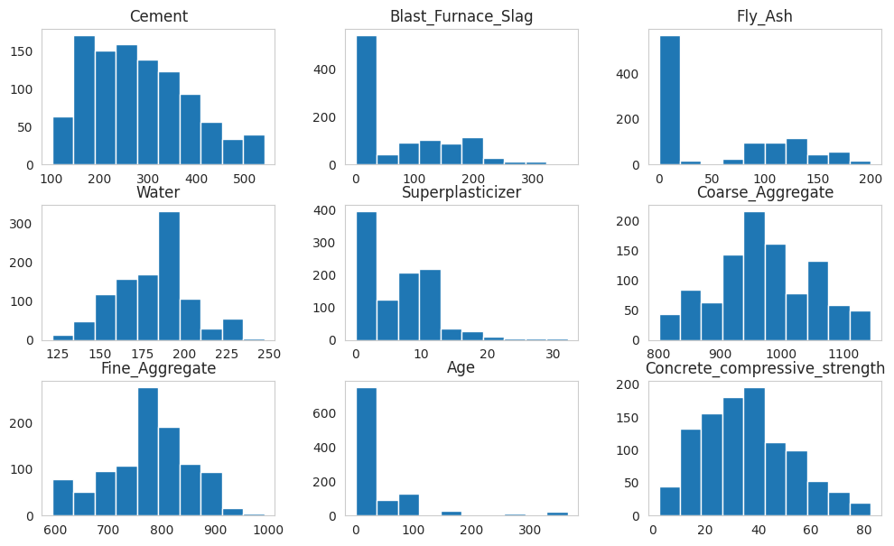
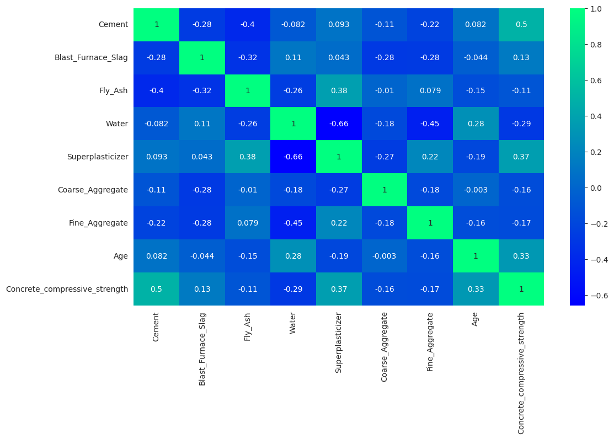

# 🏗️ Regressão da Resistência do Concreto (com Validação Cruzada)

[](https://www.python.org/)
[](https://scikit-learn.org/)
[](https://pandas.pydata.org/)
[](https://numpy.org/)
[](https://seaborn.pydata.org/)
[](https://jupyter.org/)
[](https://www.cesar.school/)

> **Portfólio Acadêmico — Pós-Graduação em Engenharia e Análise de Dados (CESAR School)**  
> **Disciplina:** Modelos Preditivos Clássicos (`Atv. 06`)  
> **Tema:** Regressão da Resistência à Compressão do Concreto com Análise Exploratória, Padronização, Redução de Dimensionalidade (PCA) e Validação Cruzada.

---

## 📌 1. Objetivo e Problema de Negócio

### Objetivo
Resolver um problema de regressão de ponta a ponta, incluindo análise exploratória, pré-processamento, modelagem com diferentes algoritmos (`LinearRegression` e `KNeighborsRegressor`), uso de redução de dimensionalidade (`PCA`) e aplicação de **validação cruzada (`5-fold cross-validation`)** para avaliação robusta dos modelos.

### Problema de Negócio
Uma empresa de engenharia civil deseja otimizar a produção de concreto. A resistência à compressão do concreto é uma de suas propriedades mais importantes, mas testá-la em laboratório é um processo lento e custoso. O objetivo é desenvolver um modelo de Machine Learning para prever a **Resistência à Compressão do Concreto (`Concrete_compressive_strength`)** com base nas quantidades de cada um dos seus **8 componentes**.

---

## 🔄 2. Fluxo do Projeto



---

## 📋 3. Dicionário de Dados

Base carregada a partir do *UCI Machine Learning Repository* (`Concrete_Data.xls`, **1.030 registros** e **9 colunas**, sem valores nulos):

| Coluna | Descrição | Unidade |
| :--- | :--- | :---: |
| **`Cement`** | Quantidade de cimento na mistura | $\text{kg/m}^3$ |
| **`Blast_Furnace_Slag`** | Quantidade de escória de alto forno na mistura | $\text{kg/m}^3$ |
| **`Fly_Ash`** | Quantidade de cinza volante na mistura | $\text{kg/m}^3$ |
| **`Water`** | Quantidade de água na mistura | $\text{kg/m}^3$ |
| **`Superplasticizer`** | Quantidade de superplastificante na mistura | $\text{kg/m}^3$ |
| **`Coarse_Aggregate`** | Quantidade de agregado grosso na mistura | $\text{kg/m}^3$ |
| **`Fine_Aggregate`** | Quantidade de agregado fino na mistura | $\text{kg/m}^3$ |
| **`Age`** | Idade do concreto (tempo desde a mistura) | Dias |
| **`Concrete_compressive_strength`** | **Variável alvo** — Resistência à compressão do concreto | **MPa** |

---

## 🔎 4. Análise Exploratória de Dados (EDA)

### 4.1. Distribuição da Variável Alvo (`Concrete_compressive_strength`) e Valores Nulos

| Histograma e Boxplot da Variável Alvo | Mapa de Valores Nulos (`df.isnull()`) |
| :---: | :---: |
|  |  |

- **Análise da Distribuição (Pergunta 1):**  
  A variável alvo `Concrete_compressive_strength` possui semelhança com a curva normal, conforme observado no histograma acima, apresentando média de `35,82 MPa`, mediana de `34,44 MPa`, desvio padrão de `16,71 MPa` e leve assimetria positiva (`skewness = 0,4169`).

---

### 4.2. Histogramas das Variáveis e Matriz de Correlação

| Histogramas das Variáveis do Dataset | Matriz de Correlação (`df.corr()`) |
| :---: | :---: |
|  |  |

- **Análise das Correlações e Multicolinearidade (Pergunta 2):**
  - As 2 variáveis com maior correlação positiva com `Concrete_compressive_strength` são **`Cement` (`0,50`)** e **`Superplasticizer` (`0,37`)**.
  - Os pares que apresentam multicolinearidade são **`Water` e `Superplasticizer`**, com correlação negativa de **`-0,66`**, além de **`Water` e `Fine_Aggregate` (`-0,45`)**, porém mais fraca que a anterior.
  - Na regressão linear, a multicolinearidade pode ocasionar **instabilidade nos coeficientes** (pequenas alterações nos dados alteram muito os valores estimados), além de comprometer a interpretação individual dos dados.

---

## ⚙️ 5. Pré-Processamento e Modelagem com Validação Cruzada

1. **Divisão Treino e Teste (`train_test_split`):**
   - **Treino (80%):** `824 registros`
   - **Teste (20%):** `206 registros` (`random_state=42`)
2. **Padronização e Pipelines (`StandardScaler` + `PCA`):**
   - Foram construídos 4 pipelines para garantir o escalonamento correto dentro de cada um dos **5 folds** da validação cruzada:
     - `pipeline_reg`: `StandardScaler` $\rightarrow$ `LinearRegression()`
     - `pipeline_knn`: `StandardScaler` $\rightarrow$ `KNeighborsRegressor(n_neighbors=5)`
     - `pipeline_reg_pca`: `StandardScaler` $\rightarrow$ `PCA(n_components=0.95)` $\rightarrow$ `LinearRegression()`
     - `pipeline_knn_pca`: `StandardScaler` $\rightarrow$ `PCA(n_components=0.95)` $\rightarrow$ `KNeighborsRegressor(n_neighbors=5)`

---

## 📊 6. Resultados da Validação Cruzada (5 Folds) e Teste Final

### Tabela Comparativa (`df_resultados` — Ordenada por Menor RMSE Médio)

| Modelo | RMSE Médio | RMSE Std | R² Médio | R² Std |
| :--- | :---: | :---: | :---: | :---: |
| **1. KNN (`k=5`, sem PCA)** | **`9,2268`** | **`0,9852`** | **`0,6958`** | **`0,0557`** |
| **2. KNN com PCA (`95%`)** | `9,2605` | `1,0746` | `0,6927` | `0,0625` |
| **3. Regressão Linear (sem PCA)** | `10,6652` | `1,0303` | `0,5945` | `0,0655` |
| **4. Regressão Linear com PCA (`95%`)** | `11,2400` | `1,2157` | `0,5516` | `0,0691` |

- **Desempenho e Estabilidade na Validação Cruzada (Pergunta 3):**  
  Com base em `df_resultados`, o modelo que apresentou o melhor desempenho foi o **KNN (`k=5`) sem PCA**, obtendo o menor valor médio de RMSE (`9,2268`) e o maior R² médio (`0,6958`). Além disso, mostrou-se o modelo mais estável, com o menor desvio padrão (`0,9852` no RMSE e `0,0557` no R²). Um desvio padrão alto indica que o desempenho do modelo varia muito a depender dos dados utilizados para treino e validação, sinalizando um modelo menos confiável.

- **Impacto do PCA (Pergunta 4):**  
  O PCA não apresentou melhorias para nenhum dos modelos: houve uma piora na Regressão Linear (RMSE subiu de `10,6652` para `11,2400`) e, no KNN, o desempenho médio ficou praticamente igual (`9,2268` vs. `9,2605`), porém com leve piora no desvio padrão tanto do RMSE quanto do R².

### Avaliação Final no Conjunto de Teste
Treinando o melhor modelo selecionado (**`KNN (k=5) sem PCA`**) com todos os dados de treino e avaliando no conjunto de teste:
- **Modelo Selecionado:** `KNN (k=5)`
- **RMSE no Teste:** **`8,5098`**
- **R² no Teste:** **`0,7190`**

---

## 🧠 7. Conclusão Final (Pergunta 5)

- Como observado nos experimentos, a aplicação do PCA trouxe apenas piora aos resultados, aumentando o RMSE médio em `0,57` na Regressão Linear e em `0,03` no KNN.
- **Recomendação:** Recomenda-se a utilização do **KNN (`k=5`) sem PCA** pelo melhor desempenho tanto na validação cruzada quanto no teste final (`RMSE = 8,5098` e `R² = 0,7190`), boa estabilidade entre os folds e baixa complexidade.
- **Próximos Passos:** Testar modelos mais fortes como o **Random Forest**, observar a interferência da variável `Age` no desempenho do modelo e ajustar o hiperparâmetro `k` do KNN com o intuito de obter o melhor valor para este algoritmo.

---

## 📁 8. Estrutura do Repositório

```text
├── 06_Regressao_Resistencia_Compressao_Concreto_UCI.ipynb   # Notebook da atividade
├── assets/                                                  # Gráficos extraídos do notebook
│   ├── distribuicao_resistencia_concreto.png
│   ├── mapa_nulos_concreto.png
│   ├── histogramas_componentes_concreto.png
│   └── correlacao_heatmap_concreto.png
├── requirements.txt                                         # Dependências do projeto
├── .gitignore                                               # Arquivos ignorados pelo Git
└── README.md                                                # Documentação do repositório
```

---

## 🚀 9. Como Executar

```bash
# 1. Clone o repositório
git clone https://github.com/pepsbr/projeto-06-modelos-preditivos-classicos-regressao-concreto.git
cd projeto-06-modelos-preditivos-classicos-regressao-concreto

# 2. Instale as dependências
pip install -r requirements.txt

# 3. Execute o Jupyter Notebook
jupyter notebook 06_Regressao_Resistencia_Compressao_Concreto_UCI.ipynb
```

---

## 👤 10. Autor

- **Pedro Paulo Sant'Anna Belo Ramos** — [@pepsbr](https://github.com/pepsbr)
